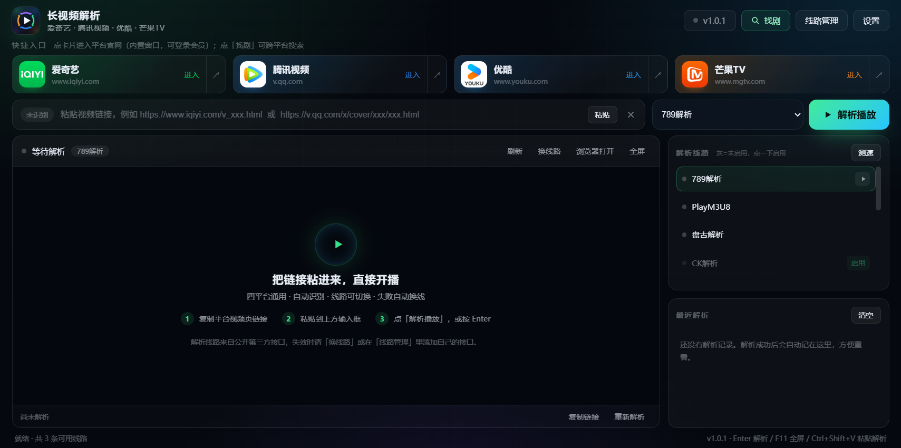

# 长视频解析

Windows 桌面端 + Android / iOS 手机端的视频链接解析播放工具：把 **爱奇艺 / 腾讯视频 / 优酷 / 芒果TV** 的视频页链接粘进来，选一条解析线路，直接在内置播放器里观看。

程序本身不提供、不存储、不分发任何视频内容；解析能力来自互联网上公开的第三方解析接口，线路失效时可自行更换或添加。

> 手机端与桌面端**同一次发布、同一版本号**：功能一致，界面按手机重新排布，并支持长按 2 倍速、双击左右快进、全屏手势。
> 桌面端点右上角「手机版」会显示二维码：手机可以扫码直接下载 Android APK，或打开 iOS 免签名 IPA 的下载页。
>
> 图文教程：软件里点右上角「使用教程」，或直接看 [PDF 版](docs/长视频解析-图文使用教程.pdf)。
>
> 开发/维护/交接说明：见 [项目开发交接文档.md](项目开发交接文档.md)（架构、数据、构建发版、测试、已知限制、下一步）。
> 项目规则见 [AGENTS.md](AGENTS.md)：**发版统一走 GitHub Actions 的 `release-all` 工作流**（桌面 + 安卓 + iOS 一次出包），不要在本机跑 NSIS 打包。




## 功能

- **手机端（1.1.0 新增）**：独立的 Android APK 与 iOS 免签名 IPA，与桌面端同一套解析 / 选集 / 历史 / 下载 / 线路管理；界面按手机重排（底部导航、抽屉式弹窗、全屏播放器），支持**长按画面 2 倍速**、双击左右快进 10 秒、上下滑动调亮度 / 音量、自动隐藏控制条。
- **桌面端点「手机版」扫码下载（1.1.0 新增）**：右上角「手机版」打开二维码；支持同一 Wi-Fi 下从电脑直传 APK/IPA（电脑没有安装包时先从国内镜像下载到缓存），也支持云端镜像落地页。二维码不会用在线生成接口，全部本地绘制。
- **镜像同步**：手机端和桌面端都按 `gh.monlor.com → gh-proxy.com → ghfile.geekertao.top → hk.gh-proxy.com → GitHub` 的顺序自动切换；APK/IPA 在所有镜像上是同一份文件。
- **链接解析直连播放**：粘贴视频页链接 → 自动识别平台 → 解析 → 内嵌播放（页面播放器或 m3u8/mp4 原生播放）。
- **播放器下选集条（1.0.10 新增）**：解析完一集后，视频下面直接出现整部剧的选集：点任意一集切换、上一集 / 下一集、正序 / 倒序、收起、可选的「自动连播」；四平台都支持，选集列表会记住，下次从观看历史点回来也不用重新抓。芒果走官方分集接口，腾讯 / 优酷 / 爱奇艺从平台页面或官方接口取。视频按 16:9 显示，播放时整页滚动，顶部平台入口 / 链接栏会随页面滚走，不再挡住视频。
- **主窗口内置浏览器**：点平台卡片或「找剧」，平台网页直接在主窗口里打开，不再新开窗口；带**多标签栏**、后退 / 前进 / 刷新 / 返回首页，Alt+←/→ 在网页里也能用；每个平台的「自动解析」开关分开记忆，切换标签会尽量保留滚动位置。
- **找剧 · 聚合搜索（1.0.10 增强）**：输入剧名，后台同时跑各平台搜索页并抓取结果，直接列出可点的结果：单集直接解析、整部剧打开选集；平台要求验证码 / 登录时，一键「打开平台页」回到原来的浏览器流程。
- **观看历史（1.0.11 调整）**：同一部剧只保留一条记录，记「最近看到第几集 + 这一集的进度」，之前看完的集数不再重复占位置；点记录直接从上次位置继续。支持搜索、最近 / 继续观看 / 按平台三种视图。网页解析线路也会记录进度。
- **图文教程（1.0.11 新增）**：右上角「使用教程」打开应用内图文说明，9 张真实截图用红框 / 聚光灯标出重点，覆盖主界面、粘贴解析、内置浏览器、选集、历史、线路、下载、全屏快捷键和常见问题；播放区为空时也有入口。
- **全屏快捷键修复（1.0.11）**：进入全屏后不再把焦点留在「全屏」按钮上；空格暂停 / 播放、←/→ 快退 / 快进 10 秒、↑/↓ 音量、M 静音、Esc 退出全屏，内置播放器和网页解析线路都可用；网页线路播完也会自动下一集。
- **下载 / 离线（1.0.10 新增）**：内置播放器播放的 m3u8 / mp4 可以下载；HLS 分片逐个下载并支持 AES-128 解密，最后合并成一个 `.ts` / `.mp4` 文件（不需要 ffmpeg）；有进度、可取消、可打开下载目录。第三方网页解析线路拿不到真实流地址，不支持下载。
- **线路体检（1.0.10 新增）**：启动后后台测速，失效线路自动标记、可一键隐藏 / 清理，解析时会尽量把失效线路排到最后；可在设置里关闭。
- **四个平台快捷入口**：使用各平台官方 App 图标，一键打开官网（内置浏览器窗口可登录会员）；视频页一键「填入解析」。
- **找剧 · 跨平台搜索**：输入剧名，勾选一个或多个平台，直接在各自的内置浏览器里打开搜索结果；点开任意剧集或某一集，程序自动解析到主界面播放。
- **自动解析 / 复制本集**：内置浏览器会识别剧集播放页，自动把「具体某一集」送给主界面；在非剧集页点「复制本集」会提示先进入具体某一集，避免复制成首页链接。
- **真·全屏**：一键把窗口铺满整个屏幕并进入影院模式（隐藏所有工具栏）；空格暂停/播放、←/→ 快退/快进 10 秒、↑/↓ 音量、M 静音、Esc 退出全屏，内置播放器和网页解析线路都可用。
- **芒果TV 原生解析**：内置芒果TV 官方取流接口（tk2 / getSource），不依赖第三方解析站；国内网络下优先使用，登录芒果会员后可解 VIP。
- **多线路 + 失败自动换线**：内置多条公开线路，可在「线路管理」里启停、排序、增删、测速、在线更新；灰色线路点一下即可启用。
- **本地取流代理**：第三方接口给的 m3u8/mp4 地址往往校验 Referer/UA，主进程用本地 `127.0.0.1` 代理补齐请求头并改写 HLS 播放列表（分片、密钥、子列表），解决防盗链导致的无法播放；下载分片也走这条代理。
- **自动更新**：electron-updater + GitHub Releases，多加速镜像自动切换；启动时静默检查，后台下载，提示重启安装。

## 下载与安装

### 电脑端（Windows 10/11 x64）

到 [Releases](https://github.com/fjz-hosts/changshipin-jiexi/releases/latest) 下载 `changshipin-Setup-<版本>.exe`，双击安装即可（不签名，SmartScreen 首次运行点「更多信息 → 仍要运行」）。

### 手机端（Android / iOS）

- **Android**：下载 `changshipin-android.apk` 直接安装；首次安装如果提示「未知来源」，允许一次即可。后续版本覆盖安装，配置和历史都保留。
- **iOS 免签名版**：下载 `changshipin-ios-unsigned.ipa`，用电脑上的 **Sideloadly / AltStore** 输入自己的 Apple ID 重签后安装。iOS 不能像 Android 一样直接装 IPA；到期后重新拖一次 IPA 即可，应用内配置和历史保留。
- **最方便的入口**：打开桌面版，点右上角「手机版」，手机扫二维码即可。同一 Wi-Fi 下会走「电脑直传」，速度最快；也可以切到「云端镜像」。
- 国内镜像（任选其一，路径相同）：
  `https://gh.monlor.com/https://github.com/fjz-hosts/changshipin-jiexi/releases/latest/download/changshipin-android.apk`
  `https://gh-proxy.com/https://github.com/fjz-hosts/changshipin-jiexi/releases/latest/download/changshipin-android.apk`
  iOS 把文件名换成 `changshipin-ios-unsigned.ipa`。
- 静态下载页：<https://fjz-hosts.github.io/changshipin-jiexi/mobile/>（会按 UA 推荐 Android / iOS，并列出全部镜像）。

## 使用

1. **快捷入口**：点顶部四个平台卡片，在内置浏览器里浏览视频；找到视频页后点「填入解析」，链接会自动回到主界面并开始解析。
2. **找剧**：点右上角「找剧」，输入剧名并勾选平台（可多选），程序会在后台抓取各平台结果并直接列出来；点单集结果立即解析，点整部剧结果会在内置浏览器里打开选集页。平台要求验证码 / 登录时点结果栏里的「打开平台页」手动搜索。
3. **选集**：解析成功后视频下方会出现选集条；点任意一集切换，或用「上一集 / 下一集」（快捷键 `[` / `]`、Ctrl+←/→）。选集条默认正序，可切倒序、收起；勾选「自动连播」后本集播完自动下一集。
4. **手动粘贴**：复制视频页链接（如 `https://www.iqiyi.com/v_xxx.html`、`https://v.qq.com/x/cover/.../xxx.html`、`https://v.youku.com/v_show/id_xxx.html`、`https://www.mgtv.com/b/xxx/xxx.html`），粘贴到输入框，回车或点「解析播放」。
5. **换线路**：解析页没有画面 / 白屏 / 报错时，点「换线路」；开启「失败自动换线」后程序会自动按顺序尝试下一条线路，启动体检标记为失效的线路会排在最后。
6. **下载**：内置播放器播放时点播放区上方「下载」，HLS 会合并成一个文件保存；按钮上显示进度，再点一次取消。保存位置见「设置 → 播放 → 打开下载目录」。
7. **会员内容**：已登录会员可把线路切到「官网页面（会员登录）」直接看原片，不走第三方解析。
8. **全屏**：点播放区右上角「全屏」（或 F11），窗口会铺满整块屏幕并隐藏工具栏；空格暂停/播放、←/→ 快退/快进 10 秒、↑/↓ 音量、M 静音、Esc 退出全屏。
9. **图文教程**：点右上角「使用教程」，或播放区为空时点「第一次用？打开图文教程」，按章节查看带红框标注的截图和说明。

更多细节见 [使用说明.txt](desktop/使用说明.txt)。

## 解析线路

线路分三种：

| 类型 | 含义 | 典型地址 |
| --- | --- | --- |
| 网页 (`page`) | 在内置浏览器里打开第三方解析页，由解析页自己播放 | `https://jx.example.com/?url={url}` |
| 接口 (`api`) | 主进程请求接口，从 JSON/HTML 里提取 m3u8/mp4，再用内置播放器播放 | `https://api.example.com/parse?url={url}` |
| 直连 (`direct`) | 不解析，直接打开原片页面（适合已登录会员） | `direct://video` |
| 芒果内置 (`mgtv`) | 直接调用芒果TV 官方取流接口，仅用于芒果TV | `mgtv://auto` |
| 原生取流 (`native`) | 隐藏窗口打开平台原片页，嗅探播放器自己的 m3u8/mp4（实验，默认关闭） | `native://auto` |

- `native` 线路是 1.0.10 的实验功能：只对免费内容有效，会员 DRM 内容会明确失败并自动回退；爱奇艺 CDN 实测会拒绝非页面请求（HTTP 405），所以默认不启用，需要时在「线路管理」里勾选。

- `{url}` 会被替换为 `encodeURIComponent(视频链接)`；也支持 `{urlRaw}` 原样拼接。
- 接口线路会自动在返回内容里递归查找 `m3u8 / mp4 / flv` 地址（支持 JSON 字段、转义斜杠、URL 编码、HTML 内嵌地址）。
- 内置线路全部是公开接口，**随时可能失效**。默认启用的是实测能出画面的三条：789解析、PlayM3U8、盘古解析。可在「设置 → 解析线路」里：
  - 单条「测试」，看是否可访问；
  - 「在线更新线路」，从本仓库的 [`lines.json`](lines.json) 拉取最新清单（不会覆盖你自建的线路）；
  - 「恢复内置线路」，回到随程序发布的默认清单。
- 侧栏里灰色线路是「未启用」，点一下即可启用，启用后出现在线路下拉框。
- 想把线路经验分享给所有人：直接改 `lines.json` 提 PR 即可，客户端在线更新后生效。

> 解析线路来自第三方，程序无法保证任何一条线路的长期可用性，也不对第三方内容负责。

## 自动更新与发版

```
node scripts/set-version.mjs <版本>   # 桌面 + 手机 + Android/iOS 原生工程一次同步
        │
        ▼
git push main
        │
        ▼
GitHub Actions · release-all
   ├─ Windows：electron-builder NSIS + latest.yml + blockmap
   ├─ Android：Capacitor + Gradle assembleRelease（固定 sideload 签名）
   ├─ iOS：Capacitor + xcodebuild 免签名 .app → 打包 unsigned IPA
   └─ 统一发布到同一个 GitHub Release（v<版本>）
        │
        ▼
GitHub Releases（桌面安装包 + latest.yml + APK + IPA + latest-mobile.json）
        │  gh.monlor.com / gh-proxy.com / ghfile.geekertao.top / hk.gh-proxy.com / github.com / jsDelivr
        ▼
桌面 electron-updater / 手机端内置更新：启动后台检查 → 多镜像回退 → 提示安装
```

- 桌面更新配置在 `desktop/electron/package.json` 的 `build.publish`（generic provider，指向 `gh.monlor.com` 镜像）。
- 手机端更新清单是 Release 里的 `latest-mobile.json`，另有仓库内 `mobile/latest.json` 作为 jsDelivr 兜底；客户端 `mobile/www/core/updater.js` 同样多镜像回退。
- **标准发版（推荐）**：

  ```powershell
  node scripts\set-version.mjs 1.1.0
  git add -A
  git commit -m "feat: v1.1.0 <说明>"
  git -c http.proxy= -c https.proxy= push origin main
  gh workflow run release-all --ref main -f version=1.1.0
  gh run watch <run-id> --exit-status
  gh release view v1.1.0 --json tagName,assets --jq '{tag:.tagName,assets:[.assets[]|{name,size,state}]}'
  ```

- Android 签名：`mobile/keystore/changshipin-release.keystore`（公开的 sideload 开发签名，密码 `changshipin`；只有用同一签名覆盖安装才能升级）。可用 `CHANGSPIN_KEYSTORE` / `CHANGSPIN_STORE_PASSWORD` / `CHANGSPIN_KEY_ALIAS` / `CHANGSPIN_KEY_PASSWORD` 覆盖。
- iOS 免签名 IPA 只做 `CODE_SIGNING_ALLOWED=NO` 构建，不包含任何证书；用户必须用 Sideloadly / AltStore 自签。
- 本机 `desktop\release.ps1` / `build.ps1` 仅作离线备用：本机 NSIS 生成卸载器时会被安全软件 / SmartScreen / 临时目录挡住（`NSIS Error: Error writing temporary file`），不要再作为发版流程；详见 [AGENTS.md](AGENTS.md)。
- 本机安装器被 SmartScreen 挡住时，可以用 `release\win-unpacked` 直接覆盖安装目录（robocopy），功能和自动更新都正常。
- `.github/workflows/build.yml` 仍然只在推送 `v*` tag 时构建 artifact；`release.yml` 是手动触发的「桌面 + 安卓 + iOS 一次构建 + 发布」工作流，两者不冲突。

## 手机端使用

1. **安装**：Android 直接装 APK；iOS 用 Sideloadly / AltStore 自签 IPA。
2. **首页**：粘贴视频页链接或点平台卡片进入内置浏览器；内置浏览器保留登录状态，点开某一集会自动送到主界面解析。
3. **播放**：解析成功后进入播放器。**长按画面 2 倍速**，松手恢复；**双击左/右 1/3 快退/快进 10 秒**；点画面显示/隐藏控制条；上下滑动右半屏调音量、左半屏调亮度；「选集」按钮定位到选集条。
4. **全屏**：点播放器右下角全屏（或工具栏「全屏」），自动横屏并隐藏状态栏；左上角「退出全屏」或 Android 返回键退出。
5. **找剧 / 线路 / 历史 / 设置**：底部导航；「线路」打开完整线路管理（增删启停、测速、在线更新），「历史」滚动到观看历史。
6. **下载**：内置播放器的 m3u8 / mp4 可下载；Android 保存到系统「下载」目录，iOS 保存到「文件」App → 我的 iPhone → 长视频解析。网页解析线路拿不到真实流地址，不支持下载。
7. **更新**：设置 → 更新，或启动后台检查；Android 直接下载并调起安装器，iOS 跳转 IPA 下载页（需要重新自签）。

> iOS 免签名版的 7 天 / 1 年有效期由 Apple ID 签名决定，不是应用本身限制；到期后重新自签即可。

## 目录结构

```text
desktop/
  build.ps1                # 构建安装包（本机备用）
  publish.ps1              # 上传到 GitHub Releases
  release.ps1              # 一键发版（本机备用；正式发版走 CI）
  使用说明.txt
  electron/
    package.json           # appId / 版本 / electron-builder / publish
    src/
      main.js              # 主进程：窗口、菜单、托盘、IPC、官网窗口
      mobile.js            # 手机版安装包缓存 / 局域网直传 / 云端落地页
      proxy.js             # 本地取流代理（m3u8 改写 / Referer / Range）
      lines.js             # 内置线路、解析、地址提取、在线线路清单
      series.js            # 四平台选集（爱奇艺/腾讯/优酷/芒果接口）
      native.js            # 平台原生取流实验（隐藏窗口嗅探 + 可播性校验）
      download.js          # HLS/mp4 下载、AES-128 解密、合并
      store.js             # 配置 / 线路 / 历史 / 线路体检结果
      updater.js           # electron-updater + 多镜像回退
      preload.js           # 主界面 IPC 桥
      smoke.js             # 无头自检（--smoke-test，32 项）
      renderer/            # 主界面、内置官网页、官方平台图标、hls.js、二维码库
    build/icon.ico
  verify.ps1               # 发版前自检（smoke，可选 cdp-test8）

mobile/
  package.json             # Capacitor 依赖 / 版本号（与桌面端一致）
  capacitor.config.json
  www/                     # 手机端界面（复用桌面渲染层 + mobile.css / mobile.js）
    core/                  # 线路 / 选集 / 存储 / 下载 / 更新 / 原生桥
    shim.js                # Electron API 兼容层 + <webview> 原生覆盖层
  plugins/changshipin-native/  # 本地原生插件（Android Kotlin + iOS Swift）
  android/                 # Capacitor 生成的 Android 工程（CI 打 APK）
  ios/                     # Capacitor 生成的 iOS 工程（CI 打免签名 IPA）
  keystore/                # sideload 固定签名
  latest.json              # 手机端更新兜底清单（jsDelivr）
  scripts/                 # 版本 / Android / iOS 补丁 / 图标生成
  resources/icon.png       # 与桌面端同一张图标

scripts/set-version.mjs    # 桌面 + 手机版本号统一修改
docs/mobile/index.html     # 手机版静态下载页（jsDelivr / Pages）
lines.json                 # 在线线路清单
tools/webview-probe/       # 线路探针（开发用）
tools/guide/               # 图文教程截图生成（Python + CDP）
tools/cdp-test*.mjs        # 界面 / 全屏 / 找剧 / 关闭窗口的自动化验证
```

## 开发

### 桌面端

```powershell
cd desktop\electron
npm install          # 首次
npm start            # 开发运行

# 无头自检（代理改写 / 平台识别 / 选集 / 下载 / 历史合并 / 图文教程，32 项）
node_modules\.bin\electron . --smoke-test
# 再带上外网链路检查
$env:CHANGSPIN_SMOKE_ONLINE="1"; node_modules\.bin\electron . --smoke-test

# 发版前自检（自动清 ELECTRON_RUN_AS_NODE、独立配置目录）
powershell -ExecutionPolicy Bypass -File ..\verify.ps1
# 额外跑内嵌浏览器回归（需要真实网络，约 40 秒）
powershell -ExecutionPolicy Bypass -File ..\verify.ps1 -Browser
```

### 手机端

```powershell
cd mobile
npm install
npx cap sync android           # 把 www 和本地插件同步进 Android 工程

# 手机端界面快速预览（Electron 的 Chromium，不需要 Android SDK）
cd ..
Remove-Item Env:ELECTRON_RUN_AS_NODE -ErrorAction SilentlyContinue
desktop\electron\node_modules\.bin\electron.cmd mobile\dev\main.js --width 390 --height 844 --out .tmp\mobile.png
```

- 手机端界面复用 `desktop/electron/src/renderer/` 的 HTML/CSS/JS；`mobile/www/mobile.css` 负责手机布局，`mobile/www/mobile.js` 负责手势和自定义播放器，`mobile/www/shim.js` 把 `window.desktop` / `<webview>` 映射到原生能力。
- 原生插件在 `mobile/plugins/changshipin-native/`：Android 手写本地取流代理 + WebView 覆盖层；iOS 用 GCDWebServer + WKWebView。改了插件后需要重新 `npx cap sync`。
- iOS 工程在 macOS 上运行 `cd mobile/ios/App && pod install`；本机 Windows 只能预览界面，不能打 IPA。
- 版本号统一用 `node scripts/set-version.mjs <版本>`，不要手改单个文件。
- 图标：`python mobile/scripts/make-assets.py` 从 `brand-assets/icon.png` 生成 Android / iOS 图标和启动图。

- 自检会输出 PASS/FAIL，并以非零退出码表示失败；可用 `CHANGSPIN_USERDATA` 指定独立配置目录，避免污染真实配置。
- 开发/调试时如果环境设置了 `ELECTRON_RUN_AS_NODE=1`，electron 会以纯 Node 模式启动，需要先 `Remove-Item Env:ELECTRON_RUN_AS_NODE`（构建脚本已处理）。
- 图标：`python scripts/make_icon.py`（桌面端）。
- 界面验证：以 `--remote-debugging-port=9222` 启动后运行 `node tools/cdp-test8.mjs`（内嵌浏览器/自动解析/历史）和 `node tools/cdp-test9.mjs`（选集条/历史分组/下载按钮）；`cdp-test2/3/4/5/6/8` 是历史回归脚本，`cdp-test7`（旧版多窗口）已随旧代码删除。
- 发版前的自检已接进 `desktop\release.ps1`（`-SkipChecks` 可跳过）；`.github\workflows\release.yml` 是「桌面 + 安卓 + iOS」一次构建发布的 `release-all` 工作流。

## 数据与隐私

- 电脑端配置、历史记录、更新缓存：`%APPDATA%\长视频解析\`（菜单「文件 → 打开配置目录」）。
- 手机端配置、历史记录：应用私有目录（`localStorage` + Filesystem）；Android 下载在系统「下载」目录，iOS 下载在「文件」App → 我的 iPhone → 长视频解析。
- 电脑端日志：`%APPDATA%\长视频解析\logs\desktop.log`。
- 登录状态：电脑端按平台隔离在 Electron 的 `persist:platform-*` 分区；手机端使用系统 WebView / WKWebView 的 Cookie 存储。程序不上传任何本地数据。
- 解析请求直接发往你选择的第三方接口；「官网页面」线路直接访问对应平台。

## 更新记录

- **1.1.4** — 修复 iOS 内置浏览器仍然黑屏：Capacitor 的 `CAPBridgeViewController.view` 本身就是 WKWebView，把覆盖层加在它上面会被 WKWebView 内部滚动层盖住；改为加到 Capacitor WKWebView 的父视图（窗口根视图）。黑屏时浏览器视口会显示提示，不再纯黑；设置 → 关于新增「复制诊断信息」（版本 / 原生插件 / 代理地址 / WebView 创建与定位状态），方便排查。Android 仍使用 `android.R.id.content` 根视图，不受该问题影响；1.1.2 的 `Capacitor.Plugins` 修复继续生效。
- **1.1.2** — **修复手机端最关键的兼容问题**：之前只从 `Capacitor.registerPlugin` 取原生插件，但 Capacitor 注入的 `native-bridge.js` 并没有这个函数，导致取流代理、原生 WebView、文件、剪贴板和更新全部拿不到——表现为「点平台用外部浏览器打开 / 内置浏览器黑屏 / 全部线路失效」。现在改为直接使用 `window.Capacitor.Plugins[...]`，并在取不到时回退到 `registerPlugin`；手机端再次打开平台会在应用内显示网页，解析线路恢复。另隐藏平台卡片上的「外部浏览器」小箭头，避免误点；补上代理 Set-Cookie 的 CORS 暴露头。**1.1.1 及更早的手机版必须覆盖安装 1.1.4 才能修复**（旧版自身更新也依赖原生插件，可能更新不了）。
- **1.1.1** — 手机版下载体验补强：局域网下载页头部改用与桌面端/手机桌面完全相同的应用图标（不再用「长」字占位）；桌面端「手机版」弹窗、局域网页、GitHub Pages 下载页都补充了**装到手机上**的分步说明（Android：找文件 → 允许未知来源 → 安装；iOS：Sideloadly/AltStore 自签 → 信任证书 → 开发者模式 → 7 天续签），并在页面里解释「为什么 iOS 不能像 Android 一样直接装」以及 TrollStore / AltStore / SideStore / Apple Developer 等替代方案。
- **1.1.0** — **新增手机端（Android APK + iOS 免签名 IPA）**，与桌面端同一版本发布、同一套解析 / 选集 / 历史 / 下载 / 线路管理；手机界面重排为底部导航 + 抽屉弹窗，播放器支持长按 2 倍速、双击左右快进 10 秒、上下滑动调亮度 / 音量、自动隐藏控制条。桌面端右上角新增「手机版」：二维码扫码下载，支持同一 Wi-Fi 下电脑直传 APK/IPA（没有缓存时先从国内镜像下载），也可切云端镜像；二维码本地绘制，不走在线接口。手机端内置更新清单 `latest-mobile.json`，与桌面更新一样多镜像回退；APK 使用仓库内固定 sideload 签名，覆盖安装可升级。新增 `release-all` CI：一次出 Windows + Android + iOS 三端产物。手机图标与桌面端同一张原图。
- **1.0.11** — 修复全屏后键盘失效（焦点留在「全屏」按钮上）：全屏后自动把焦点还给播放器，新增全局空格/方向键/音量/静音快捷键，网页解析线路由主进程统一接管按键，跨域 iframe 也能控制；网页线路播完自动下一集。观看历史改为「一部剧一条」，只记最近一次观看的集数和进度，旧版按集记录启动时自动合并；历史分组改为按平台。新增应用内「使用教程 · 图文版」：9 张真实截图 + 红框/聚光灯标注 + 常见问题，右上角和空播放区都有入口；另附可打印的 [PDF 版](docs/长视频解析-图文使用教程.pdf)。
- **1.0.10** — 播放器下方新增选集条（四平台，上一集/下一集/倒序/收起/自动连播/记忆）；观看历史加搜索、继续观看、按剧集分组；内置浏览器加多标签栏、滚动位置、网页内 Alt+←/→/Esc/Ctrl+W、按平台记忆自动解析；线路体检（启动测速、失效标记/隐藏/清理、解析排序）；找剧聚合搜索；HLS/mp4 下载（AES-128 解密、进度、取消）；新增平台原生取流实验线路（默认关闭，失败自动回退）；清理旧版独立平台窗口代码；发版前自检与 GitHub Actions 发布工作流。
- **1.0.9** — 平台网页改为在主窗口内打开（不再另开窗口），支持后退 / 前进 / 返回首页；新增观看历史（剧名、集数、进度、续播、删除）；解析按钮不再因为长时间解析被禁用。
- **1.0.8** — 关闭 hls.js 的 blob worker（打包后 worker 偶尔起不来导致清单一直不解析），提升安装版播放稳定性。
- **1.0.7** — 修复芒果TV 原生解析被误判为境外：getSource 改用国内客户端参数 `src=mgtv`（原来用的 `intelmgtv` 是国际客户端参数，会触发版权地区限制）；实测可解析并播放 720P。取流代理改写播放列表时统一沿用原始 Referer。
- **1.0.6** — 芒果TV 原生解析失败时直接显示真实原因（地区限制 / 需要会员），不再自动回退到空播放器；自动更新恢复静默覆盖安装：不再弹安装向导和“下一步”，不再额外弹“发现新版本”；配置、登录状态、桌面快捷方式都会保留，点一次“立即重启安装”即可。
- **1.0.5** — 芒果TV 新增「原生解析」线路（官方接口直连，国内网络优先，登录会员可解 VIP）；所有内置浏览器窗口统一带解析按钮；芒果TV 播放流会携带登录 Cookie。
- **1.0.4** — 修复安装/更新后桌面快捷方式丢失：NSIS 安装时强制重建桌面与开始菜单快捷方式；自动更新改为显示安装向导（不再静默卸载升级），并新增「文件 → 重新创建桌面快捷方式」和关于页按钮。
- **1.0.3** — 修复关闭平台内置浏览器（尤其正在播放/解析时）触发主进程 `Object has been destroyed` 报错的问题；主进程未捕获异常改为只写日志，不再弹错误框。
- **1.0.2** — 平台快捷入口换成官方 App 图标；新增「找剧」跨平台搜索、点集自动解析、复制本集校验；修复全屏不铺满屏幕；灰色线路点击即可启用；解析页弹窗改为当前内置窗口打开。
- **1.0.1** — 解析页加载超时放宽到 45 秒；全部线路失败时提示已尝试的线路数量与原因。
- **1.0.0** — 首个版本：四平台快捷入口、链接解析播放、多线路自动切换、本地取流代理、自动更新。

## 免责声明

本项目仅用于学习 Electron / 流媒体播放技术，以及个人合法范围内的观看。请遵守各视频平台的用户协议与当地法律法规，不要用于传播盗版内容或商业用途。解析线路由第三方提供，其可用性、安全性与合法性由提供方负责。
